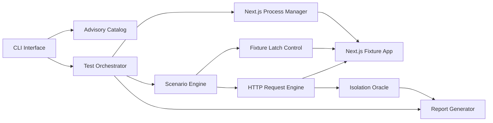
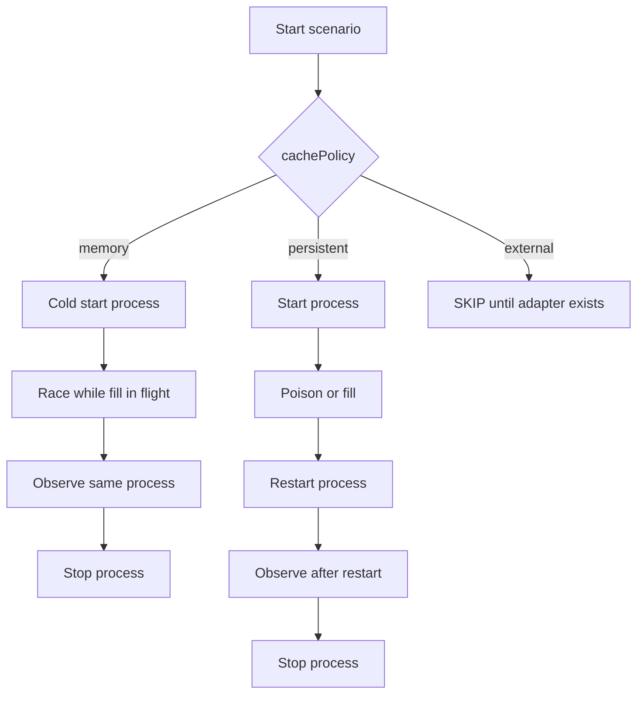
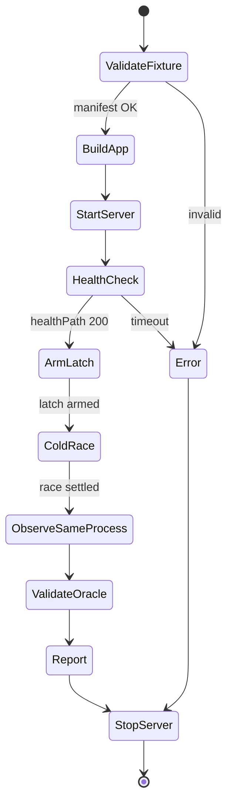

# System overview (post gap review)

Updated after the GHSA-mfr8 slice design. The original product diagram treated
cold→warm restart as global. Cache policy is now **per scenario**.

## Modules

## Per-scenario cache policies

For GHSA-mfr8 the only implemented path is `memory`: race and observe share
one process. See
[2026-11-05-ghsa-mfr8-slice-design.md](../superpowers/specs/2026-11-05-ghsa-mfr8-slice-design.md).

## GHSA-mfr8 execution

