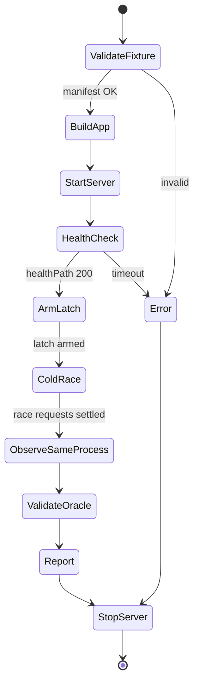

# Design: GHSA-mfr8 vertical slice

**Date:** 2026-11-05  
**Status:** Locked (builder-check questions settled in §16)  
**Advisory:** [GHSA-mfr8-8qww-v76h](https://github.com/vercel/next.js/security/advisories/GHSA-mfr8-8qww-v76h)  
**Related:** [November 2026 Security Release](https://nextjs.org/blog/november-2026-security-release), [v16.4.5](https://github.com/vercel/next.js/releases/tag/v16.4.5)  
**Milestone lock:** [2026-11-05-milestone-decision.md](./2026-11-05-milestone-decision.md)

## 1. Intent

Build the smallest end-to-end path that proves the tool can detect (and
clear) cross-root-param cache disclosure when the same public
`'use cache'` function is called both during rendering and through
`unstable_cache()`, while that function reads a root param.

This slice defines the real contracts for fixtures, cache policy, race
control, oracles, and exit codes. Generic custom YAML and the other
advisories come later and must plug into these contracts.

## 2. Goals

1. Reproduce GHSA-mfr8 on a pinned vulnerable Next.js version with
   `expected: FAIL`.
2. Clear the same scenario on Next.js `16.4.5` with `expected: PASS`.
3. Keep detection deterministic via an in-fixture latch (not bare HTTP
   barriers alone).
4. Never restart the Next.js process between the cold-fill race and the
   observation request.
5. Emit a reproducible JSON report with versions, build ID, and outcome.
6. Fail CI of *this* repository when `actual !== expected` on either
   fixture.

## 3. Non-goals

- Generic multi-tenant YAML for arbitrary user apps
- Reproducing GHSA-vc7v, GHSA-rhh4, or GHSA-vvgp
- `init` / `doctor` as a polished DX surface (stubs allowed only if they
  unblock the slice)
- GitHub Action for consumer repositories
- External/Redis cache reset adapters
- Formal proof of absence of leaks
- Telemetry or remote reporting

## 4. Anti-goals

- Treating a flaky `PASS` as “advisory fixed”
- Restarting between race and observe (destroys the evidence)
- Using `excludes-other-tenants` over the full HTML document as the
  oracle
- Health-checking the cached route (warms the cold cache)
- Shipping vulnerable fixtures inside the published npm tarball
- Encoding advisory version ranges as hard-coded doctor constants

## 5. Advisory facts this slice must encode

From the advisory and the November 2026 release notes:

| Fact | Value |
| --- | --- |
| Condition | Same public `'use cache'` fn called directly during render **and** via `unstable_cache()` |
| Required read | Root param (route param of the root layout), e.g. locale/tenant |
| Window | Cold process start; race while first fill is still in flight |
| Persistence | Contaminated entry stored under a key **without** root params; later requests for other root params get the same entry until revalidate/evict |
| Outside the race | Nesting already throws: `'use cache' inside unstable_cache() is unsupported` |
| Affected (advisory page) | `>= 16.3.0` |
| Patched (advisory page) | Listed as `None` at publication |
| Patched (release) | Next.js `16.4.5` (Active LTS). Cache Components are a 16.x feature; `15.5.29` is not the patched fixture for this suite. |

Catalog entry (versioned data, not code constants) must store:

- `affectedRange` from the advisory page
- `fixtureVulnerablePin` (exact version used by the vulnerable app)
- `fixturePatchedPin` (`16.4.5`)
- `notes` that the GHSA “Patched versions: None” field can lag the blog/tag

## 6. Repository layout for this slice

Monolith for the tool; **isolated package.json per fixture**.

```text
next-cache-isolation/
├── package.json                 # CLI package; workspaces optional
├── src/                         # tool source (modular monolith)
├── catalogs/
│   └── advisories/
│       └── GHSA-mfr8-8qww-v76h.json
├── fixtures/
│   ├── ghsa-mfr8-vulnerable/    # own package.json, pinned affected next
│   └── ghsa-mfr8-patched/       # own package.json, next@16.4.5
├── docs/
└── tests/
```

Rules:

1. Each fixture has its own `node_modules` / lockfile (or npm workspace
   with per-package `next` pin). A single root lock that hoists one
   `next` version is forbidden for this matrix.
2. Fixtures are excluded from the published npm package via
   `package.json` `files` and/or `.npmignore`.
3. Tool `tsconfig` does not compile fixture app code.
4. Builder call: prefer npm workspaces with two fixture packages over a
   single shared dependency graph.

## 7. Fixture manifest contract

Each fixture directory includes `nci.fixture.json` (name fixed for the
slice):

```json
{
  "id": "ghsa-mfr8-vulnerable",
  "advisory": "GHSA-mfr8-8qww-v76h",
  "expected": "FAIL",
  "nextVersion": "16.4.2",
  "cacheComponents": true,
  "healthPath": "/__nci/health",
  "cachePolicy": "memory",
  "scenario": {
    "id": "mfr8-cold-fill-race",
    "rootParamName": "locale",
    "contexts": [
      { "id": "pt", "rootParams": { "locale": "pt-BR" }, "sentinel": "NCI_SENTINEL_PT_BR" },
      { "id": "en", "rootParams": { "locale": "en-US" }, "sentinel": "NCI_SENTINEL_EN_US" }
    ],
    "paths": {
      "direct": "/{locale}/direct",
      "unstable": "/{locale}/unstable",
      "observe": "/{locale}/observe"
    },
    "latch": {
      "enabled": true,
      "holdMs": 2000,
      "releasePath": "/__nci/latch/release"
    },
    "oracle": {
      "type": "body-sentinel",
      "observeContext": "en",
      "mustContain": "NCI_SENTINEL_EN_US",
      "mustNotContain": ["NCI_SENTINEL_PT_BR"]
    }
  }
}
```

Notes:

- `expected` is what *this repository’s CI* asserts against `actual`.
- `sentinel` values are high-entropy strings generated **inside** the
  cached function from the root param, never from shared layout chrome.
- Path templates interpolate only declared `rootParams`.
- `locale` here is a **root route param**, not `Accept-Language`.

## 8. Cache policy: `memory`

```text
type CachePolicy = "memory" | "persistent" | "external";
```

This slice implements only `memory`.

### Runtime mode (locked)

Fixtures are exercised with **production** serving only:

1. `next build`
2. `next start` (or the fixture `startCommand` equivalent)

`next dev` is forbidden for published-suite runs. Dev-server caching and
HMR do not match the advisory’s cold-process / in-memory fill model.

### `memory` semantics for GHSA-mfr8

1. **Before race:** process may be fresh (cold start after build) or
   restarted so no prior fill exists.
2. **During race:** same Node process; no restart.
3. **Between race and observe:** **no restart**. Contaminated entry must
   still be in process memory.
4. **After scenario:** stop process; cleanup children on error paths.
5. Deleting `.next` mid-suite is out of scope; rebuild only between
   fixture apps, not between race and observe.

`persistent` (needed later for GHSA-vvgp) and `external` stay unimplemented
stubs that return `SKIP` with reason if selected.

## 9. Execution state machine (per scenario)



Differences from the original product diagram:

- No global “ColdRestart → WarmCache” between race and validation.
- Health check hits `healthPath` only.
- Latch is armed before the race.

### Race procedure

1. Start process cold.
2. Arm latch so the `'use cache'` body blocks after starting its fill.
3. Fire concurrent requests:
   - Context A → `direct` path (render path that calls `'use cache'`
     directly).
   - Context B → `unstable` path (calls the same function through
     `unstable_cache()`).
4. Release latch (or let `holdMs` elapse).
5. Wait for both race responses (record status; errors from nesting
   outside the race window are instrumentation signals, not oracles).
6. **Same process:** request `observe` for the context that must *not*
   see the other context’s sentinel.
7. Run oracle on the observe response body (and status if declared).

HTTP barrier may still synchronize *send* time. The latch makes the
in-flight fill overlap deterministic. Custom user-app scenarios later may
omit the latch and must mark results as probabilistic in the report.

## 10. Fixture application shape

Minimum routes (App Router, `cacheComponents: true`):

| Route | Role |
| --- | --- |
| `app/[locale]/layout.tsx` | Root layout; declares root param |
| Shared module | Public async function with `'use cache'` that reads root param via `next/root-params` (or equivalent API for the pinned version) and returns HTML/text including the sentinel |
| `app/[locale]/direct/page.tsx` | Calls the cached function directly during render |
| `app/[locale]/unstable/page.tsx` | Calls the same function through `unstable_cache()` |
| `app/[locale]/observe/page.tsx` | Calls via the path that surfaces the poisoned `unstable_cache` key (or direct read of stored entry as documented in fixture README) |
| `app/__nci/health/route.ts` | Returns 200; no cache; no root-param data |
| Latch control | Fixture-local only (e.g. in-memory promise gated by `holdMs` / release route). Never part of the published CLI API for third-party apps |

Vulnerable pin: choose an exact version in `>= 16.3.0` that still exhibits
the race under this procedure (builder verifies during implementation;
catalog records the pin that was proven).

Patched pin: `16.4.5`. Same source tree as vulnerable except `next`
version (and any config required for Cache Components on that version).

## 11. Oracle

MVP oracle for this slice: `body-sentinel`.

```ts
type OracleResult = {
  passed: boolean;
  expectedSentinel: string;
  forbiddenSentinelsFound: string[];
  statusCode: number;
  durationMs: number;
  bodyExcerpt?: string; // redacted, size-capped
};
```

Rules:

1. Observe response `statusCode` must be 200 unless the manifest declares
   otherwise.
2. Body must contain `mustContain`.
3. Body must contain none of `mustNotContain`.
4. Excerpt in reports: max 2 KiB, no cookies/Authorization headers logged.
5. Do not scan shared layout for “other tenant” strings.
6. Do not treat race-request bodies as the isolation oracle; they are
   race instrumentation.

Mapping to scenario result:

| Condition | `actual` |
| --- | --- |
| Oracle passed | `PASS` |
| Oracle failed (wrong/missing sentinel) | `FAIL` |
| Manifest/version precondition unmet | `SKIP` |
| Build/start/HTTP/harness failure | `ERROR` |

## 12. Regression vs user product (exit codes)

Two consumers share the runner; they disagree on what exit `1` means.

### Tool repository CI (this slice)

| Code | Meaning |
| --- | --- |
| 0 | At least one fixture ran, none `ERROR`, and every non-`SKIP` fixture had `actual === expected` |
| 1 | At least one non-`SKIP` fixture had `actual !== expected`, and none were `ERROR` |
| 2 | Any fixture `actual: ERROR`, or harness/config/build failure before results |
| 3 | Suite empty or every fixture `SKIP` (nothing applicable ran) |

Priority when multiple apply: `2` > `1` > `3` > `0`.

A fixture with `expected: FAIL` and `actual: SKIP` does **not** count as a match; it contributes to exit `3` if nothing else ran, otherwise it is ignored for match/mismatch counts and listed in `skipped`.

### Future consumer CLI (deferred)

| Code | Meaning |
| --- | --- |
| 0 | All applicable scenarios `PASS` |
| 1 | One or more isolation `FAIL` |
| 2 | Config/execution error |
| 3 | Nothing applicable ran |

Reports must label `suite: "published"` vs `suite: "custom"` so a custom
`PASS` is never read as “advisories cleared”.

## 13. Report shape (minimum)

```ts
type SliceReport = {
  toolVersion: string;
  suite: "published";
  nodeVersion: string;
  startedAt: string;
  completedAt: string;
  fixtures: Array<{
    id: string;
    advisory: string;
    scenarioId: string; // required; from manifest scenario.id
    nextVersion: string;
    buildId: string | null; // required field; null only if build never completed
    cachePolicy: "memory";
    expected: "PASS" | "FAIL";
    actual: "PASS" | "FAIL" | "SKIP" | "ERROR";
    skipReason?: string;
    errorMessage?: string;
    oracle?: OracleResult;
  }>;
  summary: {
    total: number;
    matched: number; // actual === expected among non-SKIP, non-ERROR
    mismatched: number;
    skipped: number;
    errors: number;
  };
};
```

Write to `.next-cache-isolation/report.json` (gitignored). Terminal
summary mirrors summary counts and fixture ids.

## 14. Security defaults for the harness

- Localhost-only base URL derived from the process manager bind address.
- No outbound hosts from test requests.
- `spawn` with argv arrays; never shell-concatenated commands.
- Kill process tree on exit / signal / error.
- No telemetry.
- Sensitive headers redacted if ever logged.

## 15. Acceptance criteria (slice)

| ID | Criterion |
| --- | --- |
| S-01 | Vulnerable fixture → `actual: FAIL`, `expected: FAIL` |
| S-02 | Patched fixture `16.4.5` → `actual: PASS`, `expected: PASS` |
| S-03 | No process restart between race and observe |
| S-04 | Health check never hits direct/unstable/observe routes |
| S-05 | Latch makes cold-fill overlap reliable in CI |
| S-06 | JSON report includes next/node/`buildId`/`scenarioId`/outcome |
| S-07 | Fixtures absent from npm pack contents |
| S-08 | Catalog JSON holds version ranges; doctor/constants do not hard-code them |
| S-09 | Exit `1` when `actual !== expected`; exit `3` when nothing ran |

## 16. Builder calls settled in this document

These were open after an independent builder read; settled here so planning
does not block on them.

| Topic | Call |
| --- | --- |
| Server mode | Always `next build` + `next start`. Never `next dev` for this slice. |
| Milestone 0.1.0 ship shape | Runnable CLI bin in-repo + `npm pack` verification that fixtures are excluded. **No** public npm publish required to close the slice. |
| CI matrix | `ubuntu-latest`, Node.js `22`, both fixtures every PR on `main` and pull requests. |
| Normative source for M1 | This design + the milestone decision. The 2026-11-04 product spec is background; where it conflicts (horizontal roadmap, global cold→warm restart), this slice wins until a later design reopens those topics. |

## 17. Out of scope detail left to the builder

- Exact vulnerable pin string after empirical verification
- Whether observe uses the `unstable` route or a dedicated reader
- Latch implementation (module-level promise vs tiny control route)
- Bundler choice (`tsup` vs `tsdown`)
- Whether workspaces or separate installs are used, as long as pins do
  not collide

## 18. Next artifacts after this design

1. Architecture diagrams updated for per-scenario cache policy
   ([docs/architecture](../../architecture/)).
2. GitHub issues cut **vertically** around this slice, then follow-on
   advisories / custom YAML / Action.
3. Implementation plan under `docs/superpowers/plans/` when execution
   starts.
